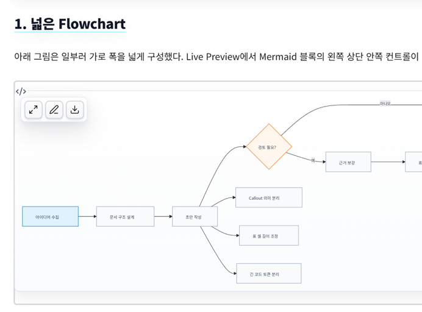
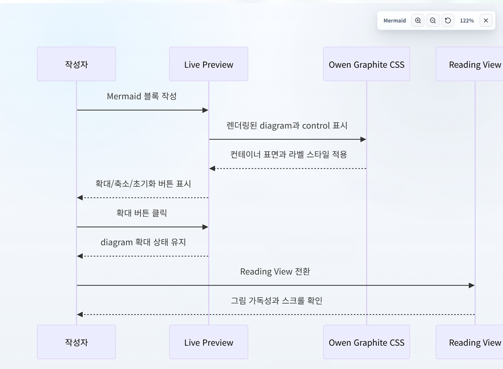
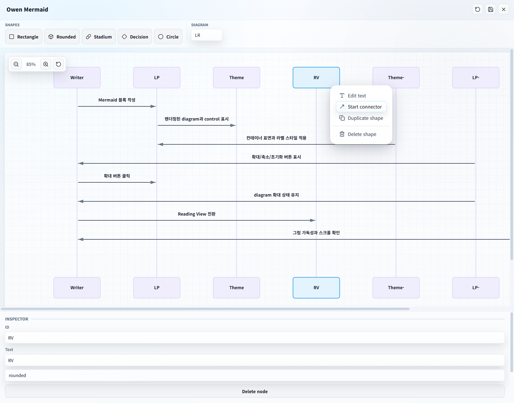
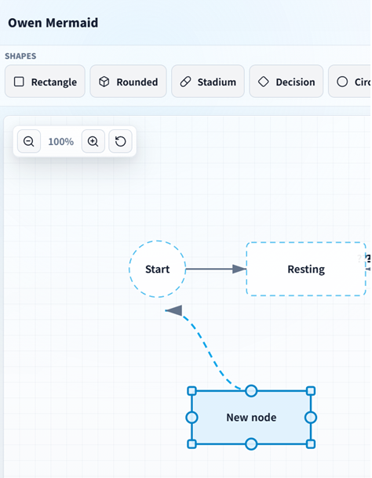
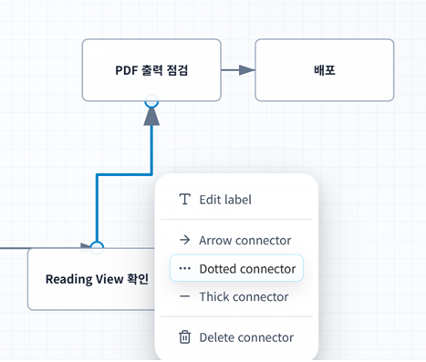
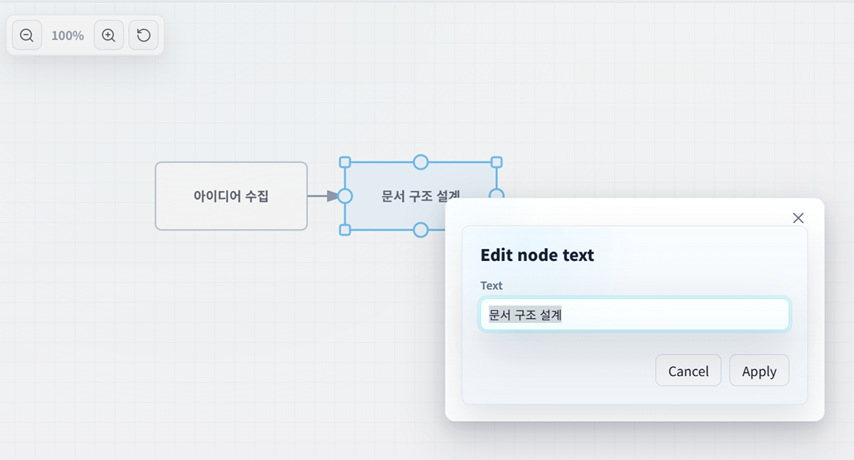
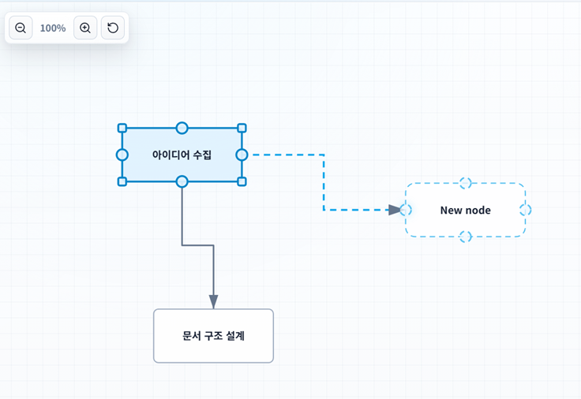
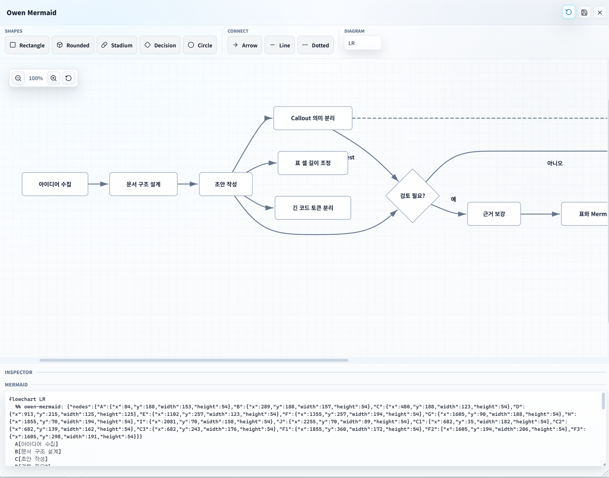
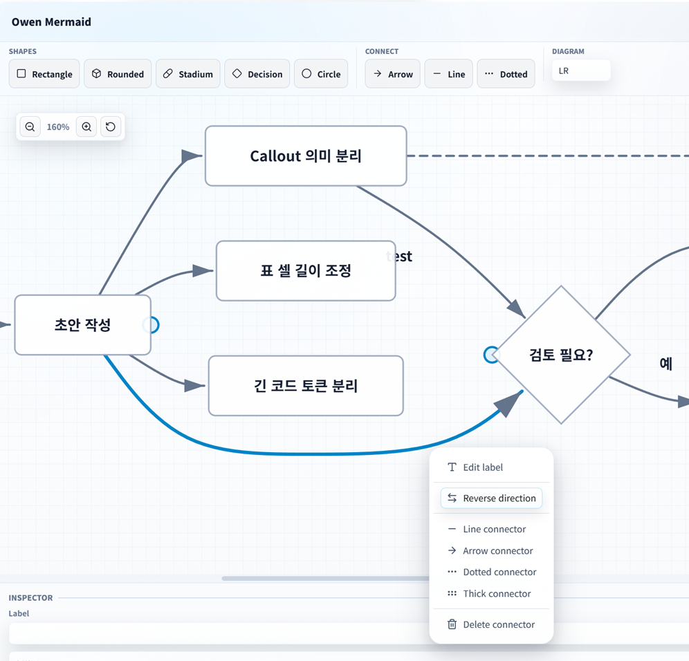
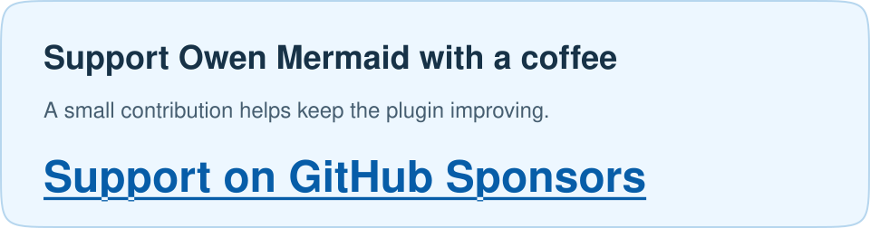

[](https://github.com/towishy/owen-mermaid/releases/latest)
[](LICENSE.md)
[](https://obsidian.md)
[](#features)

<br>
<br>
<br>


<br>

## The Owen stack

Pick the tool for the part of the workflow you want to improve. These projects work together, but you do not need to install everything.

| Project | Its role in your workflow |
| --- | --- |
| [Owen Graphite](https://github.com/towishy/Owen-Graphite) | Theme, typography, workspace styling, and PDF polish. |
| [Owen Editor](https://github.com/towishy/owen-editor) | Markdown authoring, editing commands, tables, and report helpers. |
| [Owen Exporter](https://github.com/towishy/owen-exporter) | SVG-to-image export and Markdown/HTML handoff workflows. |
| **[Owen Mermaid](https://github.com/towishy/owen-mermaid)** | Mermaid viewing, visual editing, and image export. |
| [Owen Wiki](https://github.com/towishy/owen-wiki) | A repository template for LLM-assisted knowledge operations. |

<br>

# Owen Mermaid

**View, visually edit, and export Mermaid diagrams inside Obsidian.**

Keep Mermaid source editable while using inline controls, a full-screen viewer, and a visual canvas for supported diagram structures.

**Desktop Obsidian plugin · Flowchart-focused editor · Source preservation · PNG/JPG export**

[Quick start](#quick-start) · [Features](#features) · [Preview](#preview) · [Documentation](#documentation)

<br>

## Preview





<details>
<summary>More visual editor examples</summary>








</details>

<br>

## Features

| For your workflow | What Owen Mermaid brings |
| --- | --- |
| Inspect diagrams | Inline glass toolbar, right-click actions, and a full-screen pan/zoom viewer with reset and dragging. |
| Build flowcharts | Create, drag, resize, duplicate, and delete nodes; click or drag shape tools onto the canvas. |
| Edit connections | Create, reconnect, reverse, style, label, and delete connectors/free lines; curve/straight/elbow routes, draggable labels, and self connectors. |
| Arrange the canvas | Multi-selection, group movement/deletion, alignment/distribution, snap controls with 10/20/40 spacing, background panning, fit, center-selection, and minimap. |
| Keep edits controlled | Undo/redo, source editing, source diff preview, unsaved-change prompts, and exact fenced-block targeting that rejects ambiguous stale matches. |
| Preserve layout | `%% owen-mermaid` metadata for node size/position, free lines, routes, label offsets, and colors. |
| Handle labels | Wrapping, scaling, and truncation for long or explicit multi-line node labels. |
| Export images | Single PNG/JPG download or all rendered Mermaid SVGs in the note, with scale, quality, background, destination, filename templates, and optional batch reports. |
| Work across syntax | Flowchart-focused editing plus basic state/sequence structures; unsupported lines are preserved when the parser can safely retain them. |

When adding functionality, keep the feature table and compatibility matrix current.

<br>

## Quick start

1. Open the [latest release](https://github.com/towishy/owen-mermaid/releases/latest).
2. Download **`main.js`**, **`manifest.json`**, and **`styles.css`** from **Assets**, not Source code (zip).
3. Place them directly inside `<YourVault>/.obsidian/plugins/owen-mermaid/`.
4. Reload Obsidian and enable **Owen Mermaid** under **Community plugins**.
5. Create a Mermaid code block and view the note in Reading view or Live Preview.

<br>

## Everyday workflow

1. **Inspect.** Hover a rendered Mermaid SVG or right-click it to open the viewer, edit, or download.
2. **Edit.** Use the canvas for supported shapes and connectors, or switch to the source preview for syntax-level changes.
3. **Review.** Check the diff and preserved unsupported lines before applying changes to the original fence.
4. **Export.** Save a single image or run **Export Mermaid diagrams in active note** for a batch.

<details>
<summary>Editor keyboard shortcuts</summary>

- **Ctrl/Cmd + Z:** undo.
- **Ctrl/Cmd + Y** or **Ctrl/Cmd + Shift + Z:** redo.
- **Enter:** edit selected node, connector, or free-line text.
- **Delete/Backspace:** delete selected items.
- **Arrow keys:** move the selected node/free line; **Shift + arrows** uses snap spacing.
- **Shift/Ctrl/Cmd + click:** modify the node multi-selection.
- **Escape:** cancel placement or connector tools.

</details>

Batch export uses the configured format, folder, filename, scale, background, and quality. Numeric suffixes avoid overwriting existing files. Reports can be disabled, written only for failures, or written for every batch.

<br>

## Compatibility and boundaries

Requires **desktop Obsidian 1.5.0 or later**. The interface follows Obsidian's locale, with explicit English/Korean overrides under **Settings → Owen Mermaid → Interface → Language**.

Individual settings participate in Obsidian's settings search on 1.13.0 and later; older supported hosts retain the existing grouped controls. The standalone browser editor uses a small native-DOM compatibility layer rather than requiring the Obsidian runtime.

The community filesystem-access notice is expected for saving images to a PC folder selected in the save dialog. Vault exports continue to use Obsidian's vault adapter. Thin scrollbars have a WebKit fallback; the reduced-motion rule deliberately keeps its priority so hover states cannot restore animation.

| Syntax area | Visual editing | Preservation and limits |
| --- | --- | --- |
| `flowchart` / `graph` | Yes | `TD`, `LR`, `BT`, `RL`; unsupported/missing directions use the configured direction. |
| Nodes | Yes | Rectangle, rounded, stadium, diamond, and circle; common quoted/unquoted labels. |
| Connectors | Yes | Lines, arrows, dotted/thick styles, labels, self connectors, and Owen route/label metadata. |
| Flowchart styles | Partial | `style`/`linkStyle` colors are parsed; `classDef`, `class`, and `click` lines are preserved. |
| Subgraphs | No | Preserved as source, not expanded into editable canvas items. |
| Init directives | No | `%%{init: ...}%%` remains before the regenerated header. |
| `stateDiagram` / `stateDiagram-v2` | Basic | Named states, start/end markers, basic transitions, labels, and Owen color classes. |
| `sequenceDiagram` | Basic | Participants, actors, aliases, and basic `->`, `-->`, `->>`, `-->>` messages. |
| Owen layout metadata | Yes | Visual positions, sizes, routes, label offsets, colors, and free lines. |
| Other Mermaid features | Source only | Best-effort preservation; inspect the source preview before applying. |

Visual editing is deliberately narrower than Mermaid's complete language. Preserved source is not a promise that every construct round-trips as an editable canvas item.

<br>

## Documentation

| Start here | What you will find |
| --- | --- |
| [Latest release](https://github.com/towishy/owen-mermaid/releases/latest) | Built plugin files. |
| [Plugin manifest](manifest.json) | Plugin ID and host compatibility. |
| [Package scripts](package.json) | Build, tests, release checks, and Obsidian smoke tests. |
| [Issue tracker](https://github.com/towishy/owen-mermaid/issues) | Reproduction reports and feature requests. |

<br>

## Contributing and license

After a successful release workflow, only the latest published release and its matching tag are retained. Older release downloads and tag-based rollback links are removed; source commit history is preserved. The retention workflow also supports a guarded dry run.

```bash
npm install
npm run dev
npm run build
npm test
npm run release:check
```

For the optional Obsidian smoke test, launch Obsidian with `--remote-debugging-port=9222`, then run `npm run test:obsidian`. It connects over CDP, verifies plugin commands and SVG controls, opens the editor, and removes its temporary note. Set `OWEN_MERMAID_SMOKE_SKIP_UI=1` for command-registration-only checks.

Community releases provide `main.js`, `manifest.json`, and `styles.css`. The release workflow builds and uploads these exact assets before generating their provenance attestations.

Remove private note contents from source snippets and screenshots in bug reports.

**License:** MIT — see [LICENSE.md](LICENSE.md).

---

<br>

## Support

<p align="center">
  <a href="https://mdbox.sarang.day/">
    
  </a>
</p>

<br>

<p align="center">
  <a href="https://github.com/sponsors/towishy">
    
  </a>
</p>

Owen Mermaid is free and open source. If it helps your diagram editing or image export workflow, you can support maintenance through [GitHub Sponsors](https://github.com/sponsors/towishy).
